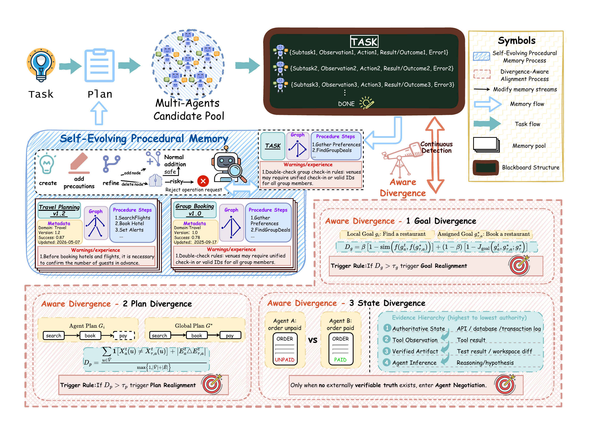
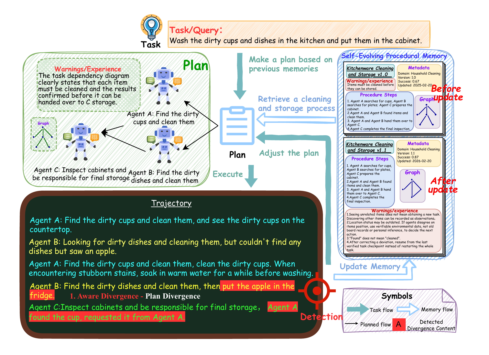
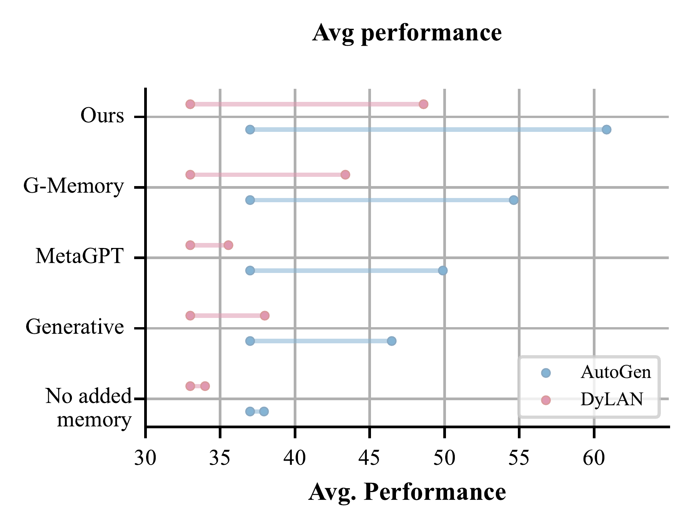
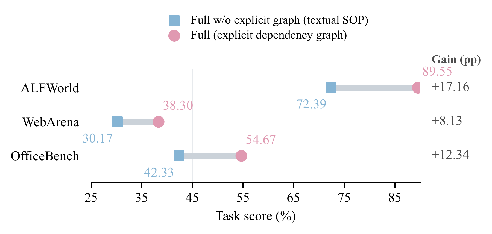
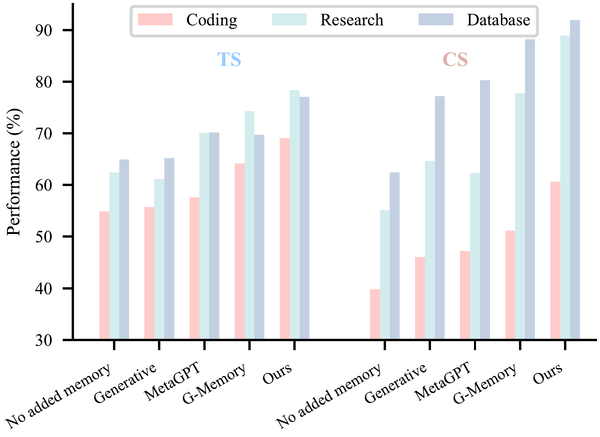
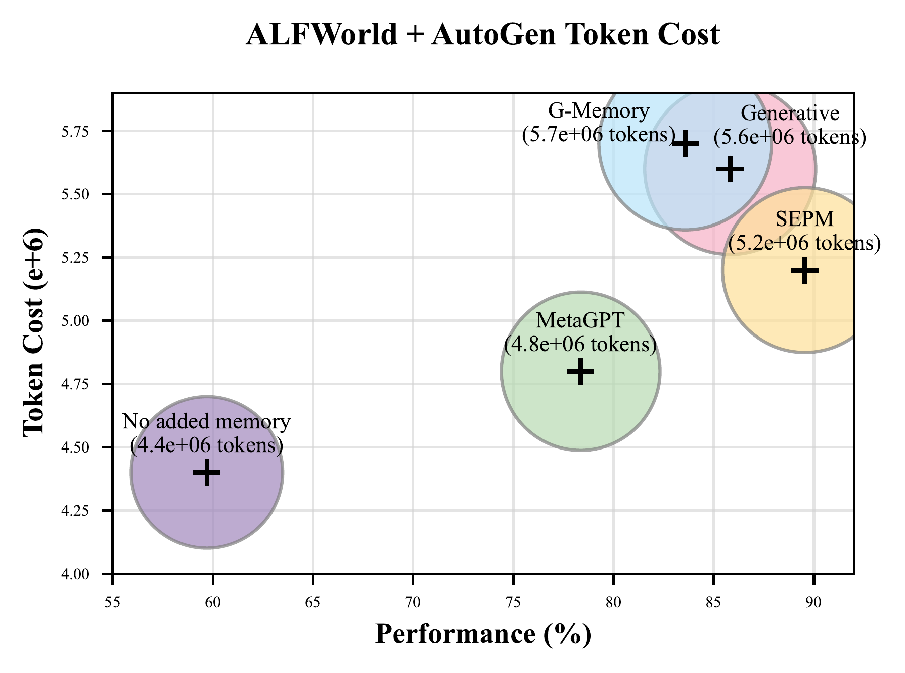

<h1 align="center">SEPM: Self-Evolving Procedural Memory Grounded in Task Graphs for Multi-Agent Collaboration</h1>

<div align="center">
  <a href="https://arxiv.org/abs/2610.14515">
    
  </a>
  <a href="https://www.python.org/downloads/">
    
  </a>
  <a href="LICENSE">
    
  </a>
</div>

<p align="center"><b>Team memory that records not only <i>what</i> to do, but also <i>what must already be true</i> before each step.</b></p>

> **TL;DR.** In a team, whether an agent can take its next step depends on what its teammates have completed. SEPM stores team procedures as **task dependency graphs**: nodes are executable steps and directed edges are cross-agent prerequisites. The same graph coordinates live execution on a shared blackboard and determines what the team retains after the task. Across seven benchmarks, SEPM ranks first against seven memory baselines in all six main settings under AutoGen and DyLAN. It raises the ImplicitMemBench score from 47.61 to 59.53. Replacing its graphs with textual prerequisites costs 8.13–16.91 points.

---

## 📑 Contents

- [👀 Overview](#-overview)
- [🧩 How SEPM Works](#-how-sepm-works)
- [🔎 Case Study](#-case-study)
- [✨ Main Results](#-main-results)
- [📁 Project Structure](#-project-structure)
- [🚀 Quick Start](#-quick-start)
- [🧪 Reproducing the Experiments](#-reproducing-the-experiments)
- [📊 More Results](#-more-results)
- [📚 Citation](#-citation)
- [📞 Contact](#-contact)

---

## 👀 Overview

Self-evolving memory lets LLM agents improve from their own experience: reflections, skills, and workflows distilled from past episodes are stored, retrieved for new tasks, and revised over time. Procedural memory is particularly effective because it records *how* a task was solved. Existing team memories extend this idea by sharing memory units, allocating them by role, or pooling trajectories in a common repository. All of them implicitly treat a procedure as a **self-contained recipe** that becomes useful once it reaches the right agent.

In collaborative tasks, a procedure is rarely self-contained. Whether a step is valid often depends on **cross-agent prerequisites**: an artifact produced by a teammate, a state change made by another agent, or a completed handoff.

<p align="center">
  <a href="docs/readme-assets/motivation.png"></a><br>
  <sub><strong>Why team memory needs a shared task graph.</strong> Three robots must wash dirty cups and dishes and store them in a cabinet. Without memory, the team stores a dirty cup in every episode. Textual memory records "store after cleaning", but no agent can check whether it holds. SEPM stores the prerequisite as a dependency edge, so C stores a cup only after A's cleaning has been verified.</sub>
</p>

This raises two questions that existing memories leave open:

1. **How should stored experience act on collaborative execution?** Experience stored as text affects behavior only if the current agent retrieves it, interprets it correctly, and acts on it. This is hard even for a single model: no model on ImplicitMemBench exceeds 66% overall. In a team, a prerequisite spans the actions of several agents, so no single agent can confirm it from its own context. Prerequisites must therefore be stored in a form that **execution can check**.
2. **What should a team retain from its experience?** A team outcome results from the interleaved actions of many agents. The order in which steps happened to occur does not reveal which steps actually enabled later ones. Memory evolution in a team is therefore a **credit assignment problem**: an update should keep only the steps and dependencies that the evidence supports.

**Key observation.** The dependencies that keep collaboration valid are the same dependencies that make experience reusable. SEPM therefore uses one task dependency graph as both the coordination structure of the current task and the representation of persistent memory.

### Key Contributions

1. **Cross-agent dependencies as the missing element.** We identify cross-agent dependencies as the missing element of self-evolving memory for agent teams, and formulate team procedural memory as task dependency graphs that serve as both the coordination structure and the memory representation.
2. **A self-evolving procedural memory for teams.** SEPM uses the shared task graph to align the goals, plans, and states of agents during execution. It evolves procedures by distilling verified steps and prerequisite edges into versioned procedures under evidence gates.
3. **Broad empirical evidence.** On seven benchmarks and two hosts, SEPM ranks first in all six main settings against seven memory baselines. It improves along the task sequence and transfers across tasks, hosts, and models. It loses 8.13–16.91 points when its graphs are replaced by textual prerequisites.

---

## 🧩 How SEPM Works

<p align="center">
  <a href="docs/readme-assets/framework.png"></a><br>
  <sub><strong>Overview of SEPM.</strong> Retrieved procedures become task graphs on a shared blackboard. The graph supports goal, plan, and state alignment during execution and drives procedure evolution afterwards.</sub>
</p>

SEPM has three components that operate on one task graph.

| Component | What it does | Code |
| --- | --- | --- |
| **Shared blackboard** | Retrieves up to *K* = 5 applicable procedures and instantiates them as a task graph bound to task entities and agents. A step is dispatched only when all of its prerequisites are verified. Each agent appends a record of *(step, observation, action, result, error)*. An outcome enters the verified state only when it is supported by external evidence (environment state, tool observations, or verified artifacts), not by agent inference alone. | [`models.py`](src/sepm/models.py), [`storage.py`](src/sepm/storage.py), [`retrieval.py`](src/sepm/retrieval.py) |
| **Divergence-aware alignment** | Compares each agent's local view with its reference subgraph along three axes. **Goal:** text dissimilarity combined with an LLM consistency judge. **Plan:** action mismatches plus prerequisite edges present in only one plan. **State:** conflicting high-confidence evidence. Divergent goals and plans are reset to the shared reference. State conflicts are resolved by an evidence hierarchy (environment → tool → verified artifact → evidence-backed negotiation). A correction invalidates the verification of every dependent step and propagates to the agents assigned to them. | [`divergence.py`](src/sepm/divergence.py), [`evidence.py`](src/sepm/evidence.py) |
| **Graph-grounded memory evolution** | After the task, SEPM keeps only verified steps and edges whose source established a condition checked before the target ran. An edge whose source merely preceded its target in time is dropped. A new workflow becomes a new procedure. A revision of an existing procedure is committed only if it passes the evidence gates below. Lessons that do not change the structure, such as "found does not imply cleaned", become conditional warnings. | [`service.py`](src/sepm/service.py), [`safety.py`](src/sepm/safety.py) |

**Prerequisite-constrained execution.** A step $w$ becomes ready only when the outcome of every prerequisite $u$ is confirmed by the verified state $\Sigma$:

```math
\operatorname{ready}(w)=\bigwedge_{(u,w)\in E}\mathbf{1}\bigl[\Sigma\models u\bigr]
```

Stored experience therefore acts on execution through the edges of the graph, not through descriptions that each agent must interpret.

**Evidence-gated evolution.** A candidate revision $S'$ is committed as a new version only if

```math
\operatorname{Accept}(S')=G_{\mathrm{safety}}\land G_{\mathrm{state}}\land G_{\mathrm{causal}}\land G_{\mathrm{reproduction}}\land\bigl[\overline{u}(S')\geq 0\bigr]
```

The gates require that $S'$ introduces no unsafe action, that its steps are consistent with the verified state, that its edges are supported by causal evidence rather than temporal order, and that it has at least one qualified trial with non-negative mean net benefit over the version it revises. Commits are atomic: the new version becomes the head only if the head has not changed since the candidate was built. Earlier versions stay in history, and **no operation deletes a procedure or a version**.

<details>
<summary><strong>Algorithm: collaborative execution and procedural memory evolution</strong></summary>

```text
Input:  task τ, procedure pool P, execution budget B_exec
Output: task outcome y and updated procedure pool P

 1  R ← RetrieveCompatible(τ, P)
 2  (G, B, Σ) ← InitializeTask(τ, R)
 3  while task unfinished and budget remains:
 4      execute a ready step, or obtain missing evidence and replan
 5      append (step, observation, action, result, error) to B
 6      update step status and resolve verified state Σ from the recorded evidence
 7      apply supported conditional warnings to the remaining steps of G
 8      if goal, plan, or state divergence is detected:
 9          realign affected agents and update G and its prerequisites
10  y ← Outcome(τ, B, Σ);  H ← (B, G, Σ, y)
11  for each candidate S' proposed from H:
12      if S' has no reference version:
13          add S' to P as a new procedure
14      else:
15          T_S' ← RecordedTrials(S')
16          if Accept(S'; T_S'):
17              atomically commit S' as a new version of its reference S
18  attach the supported conditional warnings to the head versions of the relevant procedures
19  return y, P
```

</details>

---

## 🔎 Case Study

The cleaning-and-storage task traces one full cycle of retrieval → collaboration → realignment → memory revision. The team must wash the dirty cups and dishes in a kitchen and put them in a cabinet.

<p align="center">
  <a href="docs/readme-assets/case-study.png"></a><br>
  <sub><strong>Cleaning-and-storage example.</strong> Plan divergence (B stores an apple) and state divergence (C requests a cup that has been found but not cleaned) trigger realignment, and the executed procedure is revised from v1.0 to v1.1.</sub>
</p>

1. **Retrieve and instantiate.** The team retrieves *Kitchenware Cleaning and Storage v1.0*. Its graph assigns cup cleaning, dish cleaning, and cabinet storage, and its edges encode that an item must be cleaned before it is stored.
2. **Assign work with explicit dependencies.** Agent A finds and cleans cups, Agent B finds and cleans dishes, and Agent C inspects the cabinet and handles storage. Cabinet inspection has no prerequisites and runs in parallel; storing an item depends on its owner's verified cleaning.
3. **Record execution evidence.** A reports finding cups. B cannot find dishes, notices an apple, and starts to store it in the refrigerator. C requests a cup as soon as it has been found. Every record is linked to its node in the shared task graph.
4. **Detect two kinds of divergence.** B's action is outside its assigned subgraph, so SEPM detects **plan divergence**. C's request exposes **state divergence**: "found" establishes the cup's location but not that it is clean.
5. **Realign without discarding valid progress.** Plan realignment returns B to dish cleaning. C's storage step is held by the readiness rule until A's cleaning is verified, while cabinet inspection continues. Work resumes from the last verified step rather than from scratch.
6. **Revise memory under evidence.** The verified steps and supported edges form a candidate *v1.1*, which is committed only after passing the promotion gates. The lesson "found ≠ cleaned" is attached as a conditional warning. Later tasks retrieve the revised graph together with its warnings.

---

## ✨ Main Results

**Setup.** Every memory starts empty and is built online over the same task sequence, with the same retrieval count and context budget. Planning, execution, memory, and the goal-consistency judge use `gpt-5-mini`. ALFWorld and OfficeBench are averaged over three runs with shuffled task orders; WebArena uses one run. Scores are percentages.

| Benchmark | What it tests | Scale | Metric |
| --- | --- | --- | --- |
| [ALFWorld](https://github.com/alfworld/alfworld) | Embodied household tasks | 134 tasks | Success rate |
| [WebArena](https://github.com/web-arena-x/webarena) | Stateful web tasks | 812 tasks | Functional evaluator |
| [OfficeBench](https://github.com/zlwang-cs/OfficeBench) | Cross-application office workflows | 300 tasks | Task evaluator |
| MultiAgentBench | Coding, research, and database collaboration | 3 × 100 tasks | Task Score / Coordination Score |
| TDW-MAT and C-WAH | Embodied cooperation with physical handoffs (CoELA host) | 24 TDW-MAT episodes; C-WAH | Transport rate / average steps |
| ImplicitMemBench | Whether earlier experience changes later behavior | 300 items | Benchmark score |

### 1. First in all six host–benchmark settings

<table>
  <thead>
    <tr><th rowspan="2">Memory</th><th colspan="4">AutoGen</th><th colspan="4">DyLAN</th></tr>
    <tr><th>ALFWorld</th><th>WebArena</th><th>OfficeBench</th><th>Avg.</th><th>ALFWorld</th><th>WebArena</th><th>OfficeBench</th><th>Avg.</th></tr>
  </thead>
  <tbody>
    <tr><td>No added memory</td><td align="right">59.45</td><td align="right">12.44</td><td align="right">41.33</td><td align="right">37.74</td><td align="right">53.98</td><td align="right">14.90</td><td align="right">33.56</td><td align="right">34.15</td></tr>
    <tr><td>Generative Agents</td><td align="right">85.32</td><td align="right">15.27</td><td align="right">38.67</td><td align="right">46.42</td><td align="right">65.17</td><td align="right">15.27</td><td align="right">32.89</td><td align="right">37.78</td></tr>
    <tr><td>MetaGPT</td><td align="right">77.86</td><td align="right">25.99</td><td align="right">45.11</td><td align="right">49.65</td><td align="right">49.50</td><td align="right">22.41</td><td align="right">35.22</td><td align="right">35.71</td></tr>
    <tr><td>G-Memory</td><td align="right">83.08</td><td align="right">30.30</td><td align="right">49.67</td><td align="right">54.35</td><td align="right">62.19</td><td align="right">25.49</td><td align="right">42.44</td><td align="right">43.37</td></tr>
    <tr><td>LEGOMem</td><td align="right">84.08</td><td align="right">31.65</td><td align="right">51.33</td><td align="right">55.69</td><td align="right">63.68</td><td align="right">26.35</td><td align="right">43.78</td><td align="right">44.60</td></tr>
    <tr><td>MATM</td><td align="right">81.34</td><td align="right">29.31</td><td align="right">48.44</td><td align="right">53.03</td><td align="right">61.44</td><td align="right">24.75</td><td align="right">41.22</td><td align="right">42.47</td></tr>
    <tr><td>AWM<sup>†</sup></td><td align="right">80.10</td><td align="right">26.48</td><td align="right">46.44</td><td align="right">51.01</td><td align="right">60.70</td><td align="right">23.40</td><td align="right">38.89</td><td align="right">41.00</td></tr>
    <tr><td>Memp<sup>†</sup></td><td align="right">82.09</td><td align="right">27.34</td><td align="right">47.22</td><td align="right">52.22</td><td align="right">62.44</td><td align="right">24.14</td><td align="right">39.56</td><td align="right">42.05</td></tr>
    <tr><td><strong>SEPM</strong></td><td align="right"><strong>89.05</strong></td><td align="right"><strong>38.30</strong></td><td align="right"><strong>54.44</strong></td><td align="right"><strong>60.60</strong></td><td align="right"><strong>68.41</strong></td><td align="right"><strong>29.80</strong></td><td align="right"><strong>47.11</strong></td><td align="right"><strong>48.44</strong></td></tr>
    <tr><td><em>Gain over no memory</em></td><td align="right"><em>+29.60</em></td><td align="right"><em>+25.86</em></td><td align="right"><em>+13.11</em></td><td align="right"><em>+22.86</em></td><td align="right"><em>+14.43</em></td><td align="right"><em>+14.90</em></td><td align="right"><em>+13.55</em></td><td align="right"><em>+14.29</em></td></tr>
  </tbody>
</table>

<sub><strong>Task performance under two host systems.</strong> ALFWorld and OfficeBench: mean of three runs; WebArena: one run. <sup>†</sup> Single-agent memory adapted to the team with role-specific allocation (following LEGOMem). Bold marks the best result in each column.</sub>

<p align="center">
  <a href="docs/readme-assets/overall-performance.png"></a><br>
  <sub><strong>Mean task score over the three main benchmarks.</strong> Dashed lines mark each host without added memory.</sub>
</p>

- The strongest baseline changes with the environment: Generative Agents on ALFWorld and LEGOMem on WebArena and OfficeBench. SEPM exceeds it by **3.73 / 6.65 / 3.11** points under AutoGen and **3.23 / 3.45 / 3.33** under DyLAN.
- The three-benchmark mean rises from **37.74 to 60.60** under AutoGen and from **34.15 to 48.44** under DyLAN, 4.91 and 3.84 points above LEGOMem.
- All six gains over no added memory are significant (*p* < 10<sup>−4</sup>; see [significance tests](#more-significance)).
- Single-agent procedural memories (AWM, Memp) trail team memories on WebArena and OfficeBench even with role-specific allocation. Delivering a procedure to the right agent does not establish the cross-agent prerequisites its steps depend on.

### 2. The gain comes from explicit graphs, not from better text

This ablation isolates SEPM's central design choice. **Full w/o explicit graph** states each step's prerequisites as text instead of graph edges, with the same content, retrieval rules, context budget, and update mechanism.

<p align="center">
  <a href="docs/readme-assets/graph-vs-text.png"></a><br>
  <sub><strong>Ablation under AutoGen.</strong> Bars add the blackboard, memory, and alignment in turn; Full w/o explicit graph uses information-matched textual procedures.</sub>
</p>

| AutoGen configuration | ALFWorld | WebArena | OfficeBench |
| --- | ---: | ---: | ---: |
| No added components | 59.45 | 12.44 | 41.33 |
| Blackboard only | 68.91 | 27.71 | 44.89 |
| Blackboard + memory | 86.07 | 33.99 | 45.22 |
| Blackboard + alignment | 81.84 | 34.48 | 50.89 |
| Full w/o explicit graph (textual prerequisites) | 72.14 | 30.17 | 42.22 |
| **Full SEPM** | **89.05** | **38.30** | **54.44** |

<sub>ALFWorld and OfficeBench: mean of three runs; WebArena: one run.</sub>

- **Removing the graph costs 16.91 / 8.13 / 12.22 points.** On OfficeBench, the textual variant falls below the blackboard alone. Without explicit edges, the readiness check and the plan comparison must recover prerequisites from descriptions, and errors in that recovery are passed on to alignment and memory updates rather than corrected by them.
- **The blackboard alone adds 9.46 / 15.27 / 3.56 points**, most on WebArena, where every agent must observe a shared web state consistently.

<table>
  <tr>
    <td width="58%" align="center" valign="top">
      <a href="docs/readme-assets/component-gains.png"></a><br>
      <sub><strong>Conditional gain of each component.</strong></sub>
    </td>
    <td width="42%" align="center" valign="top">
      <a href="docs/readme-assets/component-interaction.png"></a><br>
      <sub><strong>Interaction</strong> <i>I</i> = <i>s</i><sub>BMA</sub> − <i>s</i><sub>BM</sub> − <i>s</i><sub>BA</sub> + <i>s</i><sub>B</sub> (B: blackboard, M: memory, A: alignment).</sub>
    </td>
  </tr>
</table>

Memory adds **17.16 points** on top of the blackboard on ALFWorld, where action sequences and their prerequisites recur across tasks. On OfficeBench, memory and alignment are **complementary** (*I* = +3.22): memory adds 0.33 points alone but 3.55 points with alignment, because a retrieved procedure pays off only when alignment keeps cross-application state consistent with its prerequisites. On ALFWorld and WebArena the two partly overlap.

### 3. Memory that keeps improving along the task sequence

<p align="center">
  <a href="docs/readme-assets/learning-curve.png"></a><br>
  <sub><strong>Task score along the task sequence under AutoGen</strong>, split into five equal segments (B1–B5). Labels give the B1-to-B5 gain of SEPM (bold) and G-Memory.</sub>
</p>

Without added memory, scores stay flat. SEPM improves by **12.11 / 11.31 / 8.89** points from B1 to B5 on ALFWorld / WebArena / OfficeBench, versus 9.40 / 6.95 / 5.56 for G-Memory. Its margin widens from 3.70 to 6.41, from 5.52 to 9.88, and from 3.33 to 6.66 points.

The pool grows **selectively**: most candidate revisions are rejected (133 of 164, 737 of 904, and 283 of 354), most often by the causal-attribution gate. Steps that merely co-occur in a trajectory rarely enter memory (details in [pool dynamics](#more-pool)).

### 4. Transfer across task types, hosts, and models

<p align="center">
  <a href="docs/readme-assets/transfer.png"></a><br>
  <sub><strong>Transfer of frozen SEPM pools (one run).</strong> (a) ALFWorld leave-one-type-out; hollow markers show online SEPM. (b) Transfer across hosts and models.</sub>
</p>

- **New task types.** A pool built on five ALFWorld task types and frozen before testing on the sixth reaches **82.09%**, above frozen G-Memory (77.61%) and AWM (72.39%) pools and close to online SEPM (89.55%).
- **New hosts.** Without any update, a pool built under AutoGen recovers **80.0% / 86.8% / 85.7%** of DyLAN's own online gain.
- **New models.** A pool built with `gpt-5.6-terra` lifts `qwen3.5-9b` by **5.97 / 2.71 / 2.33** points above `qwen3.5-9b`'s own online pool. A stronger model extracts procedures that a weaker model does not discover on its own, and the retained structure carries this knowledge independently of the model that executes it.

### 5. Beyond the three main benchmarks

#### Task and coordination quality: MultiAgentBench

<p>
  <a href="docs/readme-assets/multiagentbench.png"></a>
  MultiAgentBench measures both the quality of a team's output (<strong>Task Score, TS</strong>) and the quality of its communication and planning (<strong>Coordination Score, CS</strong>) on 100 tasks in each of the coding, research, and database scenarios.
  <br><br>
  SEPM leads in both scores in all three scenarios. The strongest alternative is <strong>LLMA-Mem</strong>, which shares procedural memory and keeps episodic memory private. SEPM improves on it by <strong>2.44–3.17 TS</strong> and <strong>2.57–6.45 CS</strong> points, with the largest margin on research coordination.
</p>
<br clear="all">

<details>
<summary><strong>Full MultiAgentBench scores</strong></summary>

| Method | Coding TS | Coding CS | Research TS | Research CS | Database TS | Database CS |
| --- | ---: | ---: | ---: | ---: | ---: | ---: |
| No added memory | 54.90 | 39.81 | 62.40 | 55.16 | 64.93 | 62.43 |
| Generative Agents | 55.74 | 46.09 | 61.16 | 64.64 | 65.21 | 77.16 |
| MetaGPT | 57.62 | 47.23 | 70.11 | 62.27 | 70.14 | 80.29 |
| G-Memory | 64.20 | 51.17 | 74.29 | 77.77 | 69.73 | 88.20 |
| AWM<sup>†</sup> | 59.31 | 48.02 | 69.84 | 66.35 | 68.47 | 81.06 |
| LEGOMem | 63.57 | 53.88 | 73.12 | 75.40 | 71.95 | 86.13 |
| LLMA-Mem | 66.48 | 56.71 | 75.93 | 82.46 | 73.86 | 89.37 |
| **SEPM** | **69.09** | **60.64** | **78.37** | **88.91** | **77.03** | **91.94** |

<sub>AutoGen with `gpt-5-mini` for execution and `claude-opus-5` as evaluator; at most three iterations per task. Both scores keep the benchmark's reporting scale.</sub>

</details>

#### Embodied cooperation: TDW-MAT and C-WAH

In embodied cooperation, cross-agent prerequisites arise from physical handoffs. With CoELA as host, every memory is added as a plug-in.

| Memory | TDW-MAT Food (TR ↑) | TDW-MAT Stuff (TR ↑) | TDW-MAT Avg. (TR ↑) | C-WAH Steps ↓ |
| --- | ---: | ---: | ---: | ---: |
| No added memory | 68.33 | 58.33 | 63.33 | 92.4 |
| G-Memory | 72.50 | 61.67 | 67.08 | 87.1 |
| AWM<sup>†</sup> | 70.83 | 60.00 | 65.42 | 88.5 |
| LEGOMem | 73.33 | 62.50 | 67.92 | 85.6 |
| **SEPM** | **79.17** | **68.33** | **73.75** | **79.8** |

<sub>TR: transport rate (%), mean of three seeds. Steps: average steps per task, mean of five seeds.</sub>

SEPM raises the TDW-MAT transport rate from **63.33% to 73.75%** and reduces C-WAH steps from **92.4 to 79.8**, surpassing LEGOMem by 5.83 points and 5.8 steps.

#### Implicit memory: ImplicitMemBench

ImplicitMemBench tests whether earlier experience changes later behavior when the test does not refer to it, that is, whether stored experience actually **acts on execution**. In SEPM, lessons from the learning phase apply as conditional warnings to the remaining steps, and the resumed task graph keeps the exposure context available.

<p align="center">
  <a href="docs/readme-assets/implicitmembench.png"></a><br>
  <sub><strong>ImplicitMemBench scores.</strong> Dashed and dotted lines mark the oracle and a single LLM call.</sub>
</p>

With `gpt-5-mini`, SEPM raises the overall score from **47.61 to 59.53**, the highest non-oracle score on procedural memory, conditioning, and priming, whereas no baseline gains more than 3.75 points. This is **82%** of the gain of an oracle that stores the critical information manually. With `Qwen2.5-7B-Instruct`, the overall score rises from 41.12 to 50.98.

<details>
<summary><strong>Full ImplicitMemBench results</strong></summary>

| Backbone | Method | Proc. | Cond. | Prim. | Overall | Δ | Tok./item | Calls/item |
| --- | --- | ---: | ---: | ---: | ---: | ---: | ---: | ---: |
| `gpt-5-mini` | Single LLM (no MAS) | 61 | 47 | 41.27 | 49.76 | +2.15 | 2.1k | 8 |
| | AutoGen, no added memory | 58 | 45 | 39.83 | 47.61 | – | 9.6k | 31 |
| | + Generative Agents | 60 | 49 | 42.15 | 50.38 | +2.77 | 12.4k | 38 |
| | + MetaGPT | 59 | 46 | 40.62 | 48.54 | +0.93 | 10.8k | 34 |
| | + G-Memory | 61 | 52 | 41.08 | 51.36 | +3.75 | 13.1k | 39 |
| | + AWM<sup>†</sup> | 63 | 48 | 39.93 | 50.31 | +2.70 | 11.2k | 35 |
| | + Mem0 (automatic) | 60 | 51 | 38.77 | 49.92 | +2.31 | 11.7k | 37 |
| | **+ SEPM** | **71** | **64** | **43.58** | **59.53** | **+11.92** | 12.6k | 41 |
| | Mem0 + Key Info (oracle) | 74 | 79 | 33.40 | 62.13 | +14.52 | 10.1k | 32 |
| `Qwen2.5-7B` | Backbone (reported) | 50.67 | 35.67 | 44.12 | 43.49 | – | – | – |
| | MEM1 (reported) | 27.00 | 63.00 | 34.15 | 41.38 | – | – | – |
| | Mem0 + Key Info (reported) | 62.00 | 76.00 | 30.00 | 56.00 | – | – | – |
| | Single LLM (no MAS) | 50 | 36 | 43.72 | 43.24 | +2.12 | 2.3k | 8 |
| | AutoGen, no added memory | 47 | 34 | 42.37 | 41.12 | – | 10.4k | 33 |
| | + Generative Agents | 48 | 37 | 42.80 | 42.60 | +1.48 | 13.2k | 40 |
| | + MetaGPT | 47 | 35 | 41.95 | 41.32 | +0.20 | 11.6k | 36 |
| | + G-Memory | 49 | 40 | 41.27 | 43.42 | +2.30 | 14.0k | 41 |
| | + AWM<sup>†</sup> | 51 | 36 | 40.88 | 42.63 | +1.51 | 12.1k | 37 |
| | + Mem0 (automatic) | 46 | 41 | 39.63 | 42.21 | +1.09 | 12.5k | 39 |
| | **+ SEPM** | **57** | **52** | **43.95** | **50.98** | **+9.86** | 13.5k | 43 |
| | Mem0 + Key Info (oracle) | 61 | 74 | 31.27 | 55.42 | +14.30 | 10.9k | 34 |

<sub>Single run. Proc./Cond.: first-attempt accuracy; Prim.: priming influence score. Δ is relative to AutoGen without added memory. "Reported" rows are taken from the ImplicitMemBench paper; the oracle is rerun in our pipeline. Our single-LLM run of `Qwen2.5-7B-Instruct` (43.24) reproduces the reported backbone score (43.49).</sub>

Two observations stand out. The multi-agent host alone does not help: AutoGen without added memory scores below a single `gpt-5-mini` call (47.61 vs. 49.76). And the oracle reaches 62.13 overall but lowers priming to 33.40, whereas SEPM improves all three paradigms. SEPM's cost (12.6k tokens and 41 calls per item) is comparable to G-Memory's (13.1k and 39).

</details>

### 6. Robust to the execution and memory model

<p align="center">
  <a href="docs/readme-assets/model-gain.png"></a><br>
  <sub><strong>Gain over no added memory with different execution and memory models</strong> (AutoGen).</sub>
</p>

The gain over no added memory stays positive in **all 18 model–benchmark pairs**, from 3.33 to 29.85 points. Even `gpt-5.6-terra`, the strongest model without added memory, gains 12.69 / 14.54 / 11.00 points, so the benefit of explicit prerequisites persists as model capacity grows.

<details>
<summary><strong>SEPM scores with 13 execution and memory models</strong></summary>

| Model endpoint | ALFWorld | WebArena | OfficeBench |
| --- | ---: | ---: | ---: |
| qwen3.5-0.8b | 58.21 | 14.53 | 45.67 |
| qwen3.5-2b | 57.46 | 14.78 | 45.67 |
| qwen3.5-9b | 67.16 | 16.01 | 49.67 |
| qwen3.5-27b | 81.34 | 30.42 | 55.67 |
| gemma-4-12b-it | 72.39 | 22.54 | 53.00 |
| gemma-4-31b-it | 77.61 | 28.69 | 54.33 |
| deepseek-v4-flash-0731 | **93.28** | 38.05 | 64.33 |
| qwen3.8-max | 89.55 | 39.41 | 63.67 |
| glm-5.2 | 85.82 | 37.93 | 60.67 |
| kimi-k3 | 90.30 | 42.36 | 65.33 |
| gpt-5-mini (main) | 89.55 | 38.30 | 54.67 |
| gpt-5.6-terra | 91.79 | **43.23** | **67.67** |
| claude-opus-5 | 92.54 | 42.49 | 65.33 |

<sub>AutoGen; the planning agent and goal-consistency judge stay fixed while the execution and procedural-memory endpoint changes jointly. Single run with seed 0, so the main configuration differs slightly from the three-run means in the main table.</sub>

Scores span 35.82 / 28.70 / 22.00 points across models. Within Qwen3.5, scaling from 2B to 27B improves all three benchmarks, while 0.8B and 2B perform similarly. `deepseek-v4-flash-0731` is best on ALFWorld and `gpt-5.6-terra` on WebArena and OfficeBench, where it exceeds the main configuration by 4.93 and 13.00 points.

</details>

### 7. Higher success at moderate cost

<p>
  <a href="docs/readme-assets/token-cost.png"></a>
  Each point pairs a method's ALFWorld success rate (three-run mean) with the total input and output tokens of its complete 134-task evaluation under AutoGen (seed 0). Totals include coordination and memory operations together with task execution.
  <br><br>
  SEPM reaches <strong>89.05%</strong> success with <strong>5.2M</strong> tokens. No added memory uses 4.4M tokens at 59.45%; Generative Agents uses 5.6M at 85.32%; G-Memory 5.7M at 83.08%; LEGOMem 5.4M at 84.08%.
  <br><br>
  Relative to no added memory, SEPM uses about <strong>18%</strong> more tokens for <strong>+29.60</strong> points. It uses fewer tokens than Generative Agents, G-Memory, and LEGOMem on all three benchmarks (<a href="#more-cost">full cost breakdown</a>).
</p>
<br clear="all">

---

## 📁 Project Structure

```text
SEPM/
├── src/sepm/             # Core memory service: graphs, alignment, retrieval, storage
├── adapters/             # G-Memory and cross-benchmark integration bridges
├── configs/              # Adapter and benchmark configuration
├── manifests/            # Selected case IDs for local experiment plans
├── scripts/              # Setup checks, staged experiment runner, README asset rendering
├── examples/             # Small end-to-end Python example
├── tests/                # Core and integration-contract tests
├── docs/                 # Storage schema and README figure assets
├── evaluation_matrix.json
├── environment.yml       # Optional full Conda evaluation environment
└── pyproject.toml
```

Local `paper/`, `benchmark-results/`, `Evaluation/`, and `external/` directories are excluded from Git by [`.gitignore`](.gitignore). The PNGs in [`docs/readme-assets/`](docs/readme-assets/) are rendered from the paper's vector figures by [`scripts/render_readme_assets.sh`](scripts/render_readme_assets.sh), which also records the source PDF of each image.

---

## 🚀 Quick Start

### 1. Install the core package

Python 3.10 or newer is required. From the repository root:

```bash
python -m venv .venv
# Activate .venv for your shell, then:
python -m pip install -e ".[dev]"
```

### 2. Run a complete local example

```bash
python examples/end_to_end.py
sepm --db sepm_demo.db candidates
sepm --db sepm_demo.db retrieve "verified catalog results"
```

The example registers an agent, creates workspaces, proposes and validates a procedure, records a successful trial, publishes a version, and retrieves it. It writes `sepm_demo.db` in the current directory.

### 3. Check the implementation

```bash
pytest -q
sepm-benchmark --output benchmark-results/mechanism/report.json
```

`sepm-benchmark` exercises the divergence, evidence, promotion, and retrieval mechanisms deterministically, without an LLM service.

### Integrate with an agent system

[`SEPMService`](src/sepm/service.py) is the Python facade. [`AgentMemoryAdapter`](src/sepm/adapter.py) exposes agent-start, agent-step, and procedure-outcome hooks for host frameworks. The memory layer does not change the host's agent count or communication topology.

```python
from sepm.adapter import AgentMemoryAdapter
from sepm.service import SEPMService

adapter = AgentMemoryAdapter(SEPMService("sepm.db"))
context = adapter.on_agent_start(profile, workspace, task_query, context_facts=verified_facts)
step_result = adapter.on_agent_step(blackboard_entry)
adapter.on_sop_outcome(sop_id, success=True)
```

See [`examples/end_to_end.py`](examples/end_to_end.py) for concrete model objects and a runnable procedure lifecycle, and the [storage schema](docs/STORAGE_SCHEMA.md) for the graph objects, blackboard events, and SQLite version storage.

---

## 🧪 Reproducing the Experiments

The checked-in [`evaluation_matrix.json`](evaluation_matrix.json), [`manifests/`](manifests/), and [`scripts/run_paper_experiments.sh`](scripts/run_paper_experiments.sh) define a **local selected-case evaluation workflow** and its adapters. Full runs require the upstream benchmark repositories under `external/`, benchmark-specific services, and model credentials. The selected-case matrix on its own does not regenerate the full benchmark scores reported above.

For the full dependency environment on a configured server:

```bash
conda env create -f environment.yml
conda activate sepm
cp .env.example .env          # Then fill in your own credentials and endpoints
python scripts/validate_paper_setup.py --require-jobs
bash scripts/run_paper_experiments.sh all
```

The runner has `preflight`, `smoke`, `matrices`, `generality`, `sop-models`, `ablation`, and `report` stages and writes resumable results under `benchmark-results/`. [`scripts/validate_paper_setup.py`](scripts/validate_paper_setup.py) checks required jobs and external paths before a formal run. Use `python -m sepm.evaluation_runner --help` and `python -m sepm.ablation.runner --help` for matrix filters and individual stages.

**Protocol summary.** Each condition starts from an empty procedure pool stored in its own SQLite database, which persists across the task sequence (override the path with `TEAM_MEMORY_DB`). ALFWorld and OfficeBench use base seeds 0, 1, and 2, where seeds 1 and 2 are random permutations of the task order; WebArena and all other analyses use seed 0. One ALFWorld task changes a single-run score by 0.75 points and a three-run mean by 0.25 points; the corresponding steps are 0.12 for WebArena and 0.33 / 0.11 for OfficeBench.

---

## 📊 More Results

The analyses below come from the supplementary material. Each entry states **why** the experiment was run and **what it shows**. Click to expand.

<a id="more-significance"></a>
<details>
<summary><strong>A. Statistical significance</strong> — every gain over no added memory is significant</summary>

**Why.** Benchmark differences of a few points can arise from task-order effects or noise. We test whether SEPM's gains over the same host without added memory are reliable.

**How.** For ALFWorld and OfficeBench, each task has 0–3 successes over three runs; we apply a two-sided paired sign-flip permutation test (200,000 permutations) and a paired bootstrap interval (10,000 resamples). For WebArena, we apply an exact McNemar test to the paired binary outcomes.

| Host | Benchmark | Δ | W/T/L or (*b*, *c*) | 95% CI | *p* |
| --- | --- | ---: | :---: | :---: | ---: |
| AutoGen | ALFWorld | +29.60 | 61 / 65 / 8 | [21.89, 37.31] | < 10<sup>−5</sup> |
| AutoGen | WebArena | +25.86 | (24, 234) | [22.54, 29.31] | 1.9 × 10<sup>−44</sup> |
| AutoGen | OfficeBench | +13.11 | 102 / 168 / 30 | [9.11, 17.00] | < 10<sup>−5</sup> |
| DyLAN | ALFWorld | +14.43 | 46 / 73 / 15 | [7.96, 21.14] | 7 × 10<sup>−5</sup> |
| DyLAN | WebArena | +14.90 | (38, 159) | [11.70, 18.10] | 8.5 × 10<sup>−19</sup> |
| DyLAN | OfficeBench | +13.56 | 103 / 168 / 29 | [9.44, 17.67] | < 10<sup>−5</sup> |

<sub>W/T/L: tasks on which SEPM has more, equal, or fewer successes over three runs. (*b*, *c*): WebArena tasks solved only by the baseline and only by SEPM. Δ is computed from success counts and may differ from the rounded main-table entries by 0.01. *p* < 10<sup>−5</sup> means none of the 200,000 permutations was as extreme as the observed statistic.</sub>

**Finding.** All six gains are significant with *p* < 10<sup>−4</sup>, and every confidence interval lies well above zero.

</details>

<details>
<summary><strong>B. Is the gain just role allocation?</strong> — single-agent memories adapted to the team</summary>

**Why.** A natural alternative is to take a strong single-agent procedural memory and deliver each entry to the right agent. If that were enough, explicit cross-agent dependencies would be unnecessary.

**How.** Following LEGOMem, we induce AWM, Memp, and Synapse entries online from each completed task and inject them into the manager and task agents. In the *shared* variant all agents query one pool; in the *role* variant the manager receives full-task entries and each task agent receives entries for its subtask.

| Memory | Allocation | ALFWorld | WebArena | OfficeBench |
| --- | --- | ---: | ---: | ---: |
| No added memory | – | 59.45 | 12.44 | 41.33 |
| Synapse<sup>†</sup> | Shared | 75.37 | 22.91 | 43.78 |
| Synapse<sup>†</sup> | Role | 77.36 | 24.26 | 44.78 |
| AWM<sup>†</sup> | Shared | 78.61 | 25.25 | 45.67 |
| AWM<sup>†</sup> | Role | 80.10 | 26.48 | 46.44 |
| Memp<sup>†</sup> | Shared | 80.60 | 26.23 | 46.33 |
| Memp<sup>†</sup> | Role | 82.09 | 27.34 | 47.22 |
| **SEPM** | Graph-grounded | **89.05** | **38.30** | **54.44** |

<sub>AutoGen; ALFWorld and OfficeBench are means of three runs.</sub>

**Finding.** Role allocation helps every method, but only by 0.77–1.99 points. SEPM exceeds the best adapted variant (Memp, role) by 6.96 / 10.96 / 7.22 points. The difference between allocation schemes is much smaller than the difference between allocation and explicit cross-agent dependencies.

</details>

<details>
<summary><strong>C. ImplicitMemBench robustness</strong> — longer interference and a pool shared across items</summary>

**Why.** Two concerns could undermine the ImplicitMemBench result: the benefit might vanish as more unrelated text separates learning from testing, and a pool that accumulates across items might inject irrelevant procedures.

**How.** (1) We vary the interference phase from about 200 to 2000 tokens: the 200-token setting truncates the original interference, and the longer settings append neutral turns that reuse no names or symbols from the learning phase. (2) Instead of resetting the pool per item, we accumulate it across all 300 items in the original and a shuffled order.

<p align="center">
  <a href="docs/readme-assets/implicit-interference.png"></a><br>
  <sub><strong>Procedural memory first-attempt accuracy versus interference length</strong> (<code>gpt-5-mini</code>, one run). About 500 tokens corresponds to the original items.</sub>
</p>

| Pool | Proc. | Cond. | Prim. | Overall | Foreign / item | Neg. | Pos. |
| --- | ---: | ---: | ---: | ---: | ---: | ---: | ---: |
| Reset per item (main) | 71 | 64 | 43.58 | 59.53 | 0 | – | – |
| Accumulated, original order | 73 | 66 | 42.92 | 60.64 | 0.84 | 11 | 15 |
| Accumulated, shuffled order | 72 | 63 | 42.37 | 59.12 | 0.91 | 14 | 14 |

<sub>Foreign: procedures or warnings from other items injected per item. Neg./Pos.: binary items that flip from correct to incorrect, or the reverse.</sub>

**Finding.** From 200 to 2000 tokens of interference, SEPM's procedural-memory score drops only from 73 to 70, while the host without memory drops from 64 to 55 and G-Memory from 66 to 59; most of the decline occurs between 200 and 500 tokens, matching the threshold reported by ImplicitMemBench. With an accumulated pool, foreign entries are injected 0.84–0.91 times per item, the overall score changes by only +1.11 and −0.41 points, and negative transfer is matched by positive transfer. Applicability conditions and exclusions keep a growing pool free of systematic cross-item interference.

</details>

<a id="more-pool"></a>
<details>
<summary><strong>D. What enters memory</strong> — procedure-pool dynamics</summary>

**Why.** The promotion gates are meant to admit only revisions that the evidence supports. We check how many candidates they actually reject, and why.

| Statistic | ALFWorld | WebArena | OfficeBench |
| --- | ---: | ---: | ---: |
| Candidates proposed | 187 | 1046 | 412 |
| ↳ added as new procedures | 23 | 142 | 58 |
| ↳ promoted as revisions | 31 | 167 | 71 |
| ↳ rejected: safety | 4 | 31 | 9 |
| ↳ rejected: state | 29 | 176 | 72 |
| ↳ rejected: causal | 41 | 219 | 88 |
| ↳ rejected: reproduction | 38 | 203 | 74 |
| ↳ rejected: utility | 21 | 108 | 40 |
| Conditional warnings attached | 96 | 588 | 231 |
| Specialized variants created | 9 | 47 | 17 |
| Procedures at end | 32 | 189 | 75 |
| Avg. versions per procedure | 1.97 | 1.88 | 1.95 |
| Tasks retrieving ≥ 1 procedure (%) | 88.06 | 71.80 | 81.33 |

<sub>AutoGen, seed 0. New procedures are added directly; rejected candidate revisions are grouped by the first failed gate.</sub>

**Finding.** Only 28.9% / 29.5% / 31.3% of candidates enter the pool. Every rejection concerns a revision, and the causal-attribution and reproduction gates account for most of them (79 of 133, 422 of 737, and 162 of 283). Conditional warnings accumulate faster than structural revisions because a recorded failure yields a warning without passing the promotion gates. Since nothing is deleted, the ALFWorld pool ends with all 23 new procedures and 9 variants, at 1.97 versions per procedure.

</details>

<details>
<summary><strong>E. How alignment behaves</strong> — trigger statistics and hyperparameter sensitivity</summary>

**Why.** Alignment should fire on real divergences, not on noise, and it should not depend on finely tuned thresholds for each benchmark.

| Statistic | ALFWorld | WebArena | OfficeBench |
| --- | ---: | ---: | ---: |
| Goal triggers / task | 0.41 | 0.63 | 0.52 |
| Plan triggers / task | 0.87 | 1.24 | 1.36 |
| State conflicts / task | 0.58 | 0.92 | 1.11 |
| Tasks with ≥ 1 realignment (%) | 63.43 | 71.92 | 76.00 |
| Detection precision (%) | 84 | 77 | 81 |
| Inter-annotator κ | 0.71 | 0.66 | 0.69 |
| Success with realignment (%) | 87.06 | 36.47 | 51.75 |
| Success without realignment (%) | 93.88 | 42.98 | 63.89 |

<sub>AutoGen, seed 0. Precision is judged by two annotators on 100 sampled triggers per benchmark.</sub>

<p align="center">
  <a href="docs/readme-assets/alignment-sensitivity.png"></a><br>
  <sub><strong>Sensitivity to alignment hyperparameters</strong> under AutoGen (one run), varying one parameter at a time: goal threshold δ<sub>g</sub>, plan threshold δ<sub>p</sub>, goal weight β, and evidence-confidence threshold. Vertical lines mark the defaults.</sub>
</p>

**Finding.** Plan divergence is the most frequent trigger on all three benchmarks, and 77–84% of triggers are judged correct. Tasks with realignment succeed less often because realignment concentrates on harder tasks; its causal effect is measured by the component ablation, not by this comparison. Across the tested thresholds, scores vary by at most 5 ALFWorld tasks (3.73 points) and 9 OfficeBench tasks (3.00 points), and the defaults give the highest observed score for every parameter, so one configuration serves all benchmarks. Raising δ<sub>p</sub> to 0.50 causes the largest drop: missed plan divergences are the most costly.

</details>

<details>
<summary><strong>F. Team size</strong> — two, three, and five task agents</summary>

**Why.** Larger teams create more cross-agent prerequisites and more chances for agents to diverge. We test whether SEPM's benefit holds as the team grows, and how its cost scales.

| Agents | Memory | ALFWorld score | ALFWorld tokens (M) | OfficeBench score | OfficeBench tokens (M) |
| --- | --- | ---: | ---: | ---: | ---: |
| 2 | No added memory | 57.46 | 3.6 | 40.00 | 6.9 |
| 2 | G-Memory | 80.60 | 4.7 | 47.00 | 8.9 |
| 2 | **SEPM** | **86.57** | 4.3 | **51.00** | 8.2 |
| 3 (default) | No added memory | 59.70 | 4.4 | 41.67 | 8.7 |
| 3 (default) | G-Memory | 83.58 | 5.7 | 50.00 | 11.2 |
| 3 (default) | **SEPM** | **89.55** | 5.2 | **54.67** | 10.3 |
| 5 | No added memory | 55.22 | 6.3 | 40.67 | 12.6 |
| 5 | G-Memory | 79.85 | 8.4 | 48.33 | 16.4 |
| 5 | **SEPM** | **88.81** | 7.4 | **55.33** | 14.5 |

<sub>AutoGen, one run.</sub>

**Finding.** With five agents, no added memory and G-Memory decline relative to three agents on both benchmarks, whereas SEPM changes by only one ALFWorld task and two OfficeBench tasks. From three to five agents, SEPM's tokens grow by 42% and 41%, compared with 47% and 46% for G-Memory.

</details>

<details>
<summary><strong>G. Stability of the component ablation across task orders</strong></summary>

**Why.** The component ablation and its interaction term *I* could depend on the particular task order of a single run.

<p align="center">
  <a href="docs/readme-assets/ablation-seeds.png"></a><br>
  <sub><strong>Three-run mean minus the seed-0 run</strong> for each ablation configuration and the interaction <i>I</i> (points). WebArena uses one run and is omitted.</sub>
</p>

**Finding.** Every configuration shifts by at most 0.50 points on ALFWorld and 0.34 points on OfficeBench, less than one task in a single ALFWorld run (0.75) and about one task in a single OfficeBench run (0.33). The interaction *I* shifts by 0.24 and 0.12 points and keeps its sign on all three benchmarks (−9.71, −2.46, and +3.34 for seed 0), so the conditional contributions in the ablation are stable across task orders.

</details>

<a id="more-cost"></a>
<details>
<summary><strong>H. Full cost breakdown</strong> — tokens, calls, wall-clock time, and per-component share</summary>

**Why.** SEPM adds retrieval, divergence detection, realignment, and extraction on top of task execution. We measure the total overhead and where it comes from.

<table>
  <thead>
    <tr><th rowspan="2">Memory</th><th colspan="3">ALFWorld</th><th colspan="3">WebArena</th><th colspan="3">OfficeBench</th></tr>
    <tr><th>Tok. (M)</th><th>Calls</th><th>Time (s)</th><th>Tok. (M)</th><th>Calls</th><th>Time (s)</th><th>Tok. (M)</th><th>Calls</th><th>Time (s)</th></tr>
  </thead>
  <tbody>
    <tr><td>No added memory</td><td align="right">4.4</td><td align="right">21.4</td><td align="right">48</td><td align="right">61.8</td><td align="right">18.7</td><td align="right">142</td><td align="right">8.7</td><td align="right">15.2</td><td align="right">37</td></tr>
    <tr><td>Generative Agents</td><td align="right">5.6</td><td align="right">26.8</td><td align="right">61</td><td align="right">74.3</td><td align="right">23.5</td><td align="right">171</td><td align="right">11.0</td><td align="right">19.6</td><td align="right">47</td></tr>
    <tr><td>MetaGPT</td><td align="right">4.8</td><td align="right">23.1</td><td align="right">53</td><td align="right">66.2</td><td align="right">20.4</td><td align="right">155</td><td align="right">9.5</td><td align="right">16.8</td><td align="right">41</td></tr>
    <tr><td>G-Memory</td><td align="right">5.7</td><td align="right">27.5</td><td align="right">64</td><td align="right">76.9</td><td align="right">24.1</td><td align="right">178</td><td align="right">11.2</td><td align="right">20.1</td><td align="right">49</td></tr>
    <tr><td>AWM<sup>†</sup></td><td align="right">5.0</td><td align="right">24.6</td><td align="right">56</td><td align="right">69.5</td><td align="right">21.8</td><td align="right">160</td><td align="right">9.9</td><td align="right">17.7</td><td align="right">43</td></tr>
    <tr><td>LEGOMem</td><td align="right">5.4</td><td align="right">25.9</td><td align="right">59</td><td align="right">72.8</td><td align="right">22.9</td><td align="right">166</td><td align="right">10.6</td><td align="right">18.9</td><td align="right">46</td></tr>
    <tr><td><strong>SEPM</strong></td><td align="right">5.2</td><td align="right">25.2</td><td align="right">58</td><td align="right">71.4</td><td align="right">23.0</td><td align="right">168</td><td align="right">10.3</td><td align="right">18.4</td><td align="right">45</td></tr>
  </tbody>
</table>

<sub>AutoGen, seed 0. Tokens: total input and output tokens over the complete evaluation. Calls and time are per task.</sub>

| SEPM component | ALFWorld (%) | WebArena (%) | OfficeBench (%) |
| --- | ---: | ---: | ---: |
| Task execution | 84.6 | 88.9 | 85.3 |
| Retrieval and instantiation | 3.1 | 2.2 | 2.8 |
| Divergence detection | 4.7 | 3.4 | 4.6 |
| Realignment | 3.2 | 2.5 | 3.7 |
| Extraction and promotion | 4.4 | 3.0 | 3.6 |

**Finding.** SEPM uses fewer tokens than Generative Agents, G-Memory, and LEGOMem on all three benchmarks, and more than no added memory, MetaGPT, and AWM. On WebArena, its time per task (168 s) is close to LEGOMem's (166 s). Task execution accounts for 84.6–88.9% of SEPM's tokens; divergence detection is the largest added component.

</details>

<details>
<summary><strong>I. Implementation defaults</strong> — retrieval, alignment, and promotion hyperparameters</summary>

All experiments use one configuration.

| Module | Setting | Default |
| --- | --- | --- |
| Retrieval | Procedures retrieved per task (*K*) | 5 |
| Retrieval | BM25 parameters | *k*<sub>1</sub> = 1.5, *b* = 0.75 |
| Retrieval | Text representation | 256-d BLAKE2b signed feature hashing, ℓ<sub>2</sub>-normalized |
| Retrieval | Lexical / vector weights without a routing cue | 0.50 / 0.50 |
| Goal alignment | Weight β of text dissimilarity vs. LLM judge | 0.55 |
| Goal alignment | Threshold δ<sub>g</sub> | 0.35 |
| Plan alignment | Threshold δ<sub>p</sub> | 0.40 |
| State resolution | Evidence-confidence threshold | 0.70 |
| Promotion | Safety-risk threshold | 0.50 |
| Promotion | Causal-confidence threshold | 0.65 |
| Promotion | Reproduction gate | ≥ 1 qualified trial |
| Promotion | Cost weight λ in net benefit | 1.0 |

**Adaptive retrieval.** The lexical (BM25) and vector logits start at zero and are converted to weights by a softmax. Query cues raise one of the logits:

| Query cues | Logit | Increment |
| --- | --- | ---: |
| `code`, `debug`, `implement`, `coding` | Vector | 1.0 |
| `latest`, `current`, `real-time` | BM25 | 0.8 |
| `routine`, `repeat`, `standard` | BM25 | 0.6 |

**State resolution order.** Environment or official state → tool observation → verified artifact → agent inference. Agreement within the highest qualified tier establishes the value; for conflicting observations from the same source and tier, the latest is used. Confidence decides eligibility, never the outcome between contradictory values.

</details>

---

## 📚 Citation

If you find our work helpful, please consider citing it.

```bibtex
@misc{liu2026sepmselfevolvingproceduralmemory,
      title={SEPM: Self-Evolving Procedural Memory Grounded in Task Graphs for Multi-Agent Collaboration},
      author={Yi Liu and Junwei Zhao and Li Sun and Jiansong Zhang and Sen Su},
      year={2026},
      eprint={2610.14515},
      archivePrefix={arXiv},
      primaryClass={cs.MA},
      url={https://arxiv.org/abs/2610.14515},
}
```

---

## 📞 Contact

For questions, suggestions, or collaboration:

- **Yi Liu** — [louie@bupt.edu.cn](mailto:louie@bupt.edu.cn)
- Or open an issue on this repository.
