<p align="center">
  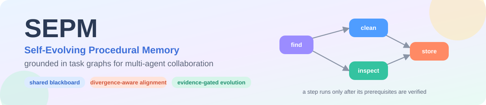
</p>

<h1 align="center">SEPM: Self-Evolving Procedural Memory Grounded in Task Graphs for Multi-Agent Collaboration</h1>

<p align="center">
  <a href="https://arxiv.org/abs/2610.14515"></a>
  <a href="https://www.python.org/downloads/"></a>
  <a href="LICENSE"></a>
  
  
</p>

<p align="center"><b>Team memory that records not only <i>what</i> to do, but also <i>what must already be true</i> before each step.</b></p>

> [!TIP]
> **TL;DR.** In a team, whether an agent can take its next step depends on what its teammates have completed. SEPM stores team procedures as **task dependency graphs**: nodes are executable steps and directed edges are cross-agent prerequisites. The same graph coordinates execution on a shared blackboard and decides what the team retains after the task.

<table>
  <tr>
    <td align="center" width="25%"><h2>🥇 6 / 6</h2><sub>main host–benchmark settings<br>ranked first vs. 7 memory baselines</sub></td>
    <td align="center" width="25%"><h2>📈 +22.86</h2><sub>points on the three-benchmark mean<br>under AutoGen (37.74 → 60.60)</sub></td>
    <td align="center" width="25%"><h2>🧠 59.53</h2><sub>ImplicitMemBench overall score<br>(host without memory: 47.61)</sub></td>
    <td align="center" width="25%"><h2>🔗 −8.1 to −16.9</h2><sub>points when graphs are replaced<br>by textual prerequisites</sub></td>
  </tr>
</table>

---

## 📑 Contents

- [👀 Overview](#-overview)
- [🧩 How SEPM Works](#-how-sepm-works)
- [🔎 Case Study](#-case-study)
- [✨ Main Results](#-main-results)
- [🚀 Quick Start](#-quick-start)
- [🧪 Running the Benchmarks](#-running-the-benchmarks)
- [📁 Project Structure](#-project-structure)
- [📊 More Results](#-more-results)
- [📚 Citation](#-citation)

---

## 👀 Overview

Self-evolving memory lets LLM agents improve from their own experience: reflections, skills, and workflows distilled from past episodes are stored, retrieved for new tasks, and revised over time. Existing team memories share memory units, allocate them by role, or pool trajectories in a common repository. All of them treat a procedure as a **self-contained recipe** that becomes useful once it reaches the right agent.

In collaborative tasks, a procedure is rarely self-contained. Whether a step is valid often depends on **cross-agent prerequisites**: an artifact produced by a teammate, a state change made by another agent, or a completed handoff.

<p align="center">
  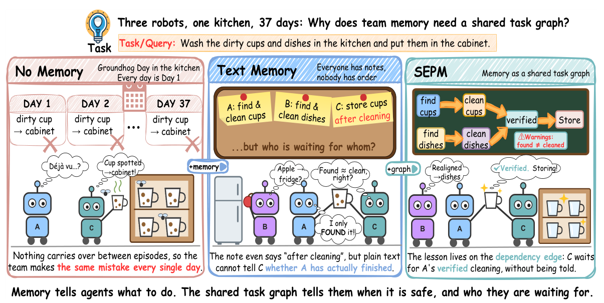<br>
  <sub><b>Why team memory needs a shared task graph.</b> Without memory, the team stores a dirty cup in every episode. Textual memory records "after cleaning", but no agent can check it. SEPM stores the prerequisite as a dependency edge, so C stores a cup only after A's cleaning is verified.</sub>
</p>

This raises two questions that existing memories leave open:

1. **How should stored experience act on collaborative execution?** Experience stored as text affects behavior only if an agent retrieves it, interprets it correctly, and acts on it. A prerequisite spans the actions of several agents, so no single agent can confirm it from its own context. Prerequisites must therefore be stored in a form that **execution can check**.
2. **What should a team retain from its experience?** The order in which interleaved steps happened to occur does not reveal which steps enabled later ones. Memory evolution in a team is a **credit assignment problem**: an update should keep only the steps and dependencies that the evidence supports.

**Key observation.** The dependencies that keep collaboration valid are the same dependencies that make experience reusable. SEPM therefore uses one task dependency graph as both the coordination structure of the current task and the representation of persistent memory.

### Contributions

- **Cross-agent prerequisites as the missing element.** We formulate team procedural memory as task dependency graphs that serve as both the coordination structure and the memory representation of the team.
- **A self-evolving procedural memory for teams.** SEPM aligns the goals, plans, and states of agents against the shared graph during execution, and distills verified steps and prerequisite edges into versioned procedures under evidence gates.
- **Broad evidence.** On seven benchmarks and two hosts, SEPM ranks first in all six main settings against seven memory baselines, improves along the task sequence, transfers across tasks, hosts, and models, and loses 8.13–16.91 points when its graphs become textual prerequisites.

---

## 🧩 How SEPM Works

<p align="center">
  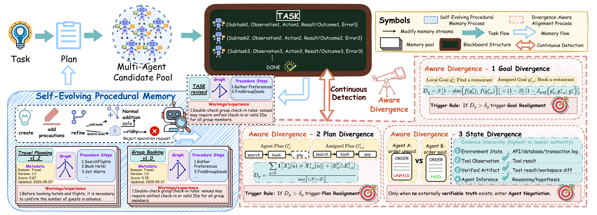<br>
  <sub><b>Overview of SEPM.</b> Retrieved procedures become task graphs on a shared blackboard, which supports goal, plan, and state alignment during execution and drives procedure evolution afterwards.</sub>
</p>

| | Component | What it does | Code |
| :---: | --- | --- | --- |
| 🟦 | **Shared blackboard** | Retrieves up to *K* = 5 applicable procedures and plans a task graph from them. A step is dispatched only when all its prerequisites are verified. Agents append *(step, observation, action, result, error)* records; an outcome is verified only by external evidence (environment state, tool observation, or verified artifact), never by agent inference alone. | [`models.py`](src/sepm/models.py), [`storage.py`](src/sepm/storage.py), [`retrieval.py`](src/sepm/retrieval.py) |
| 🟧 | **Divergence-aware alignment** | Compares each agent's local view with its reference subgraph. **Goal:** text dissimilarity plus an LLM consistency judge. **Plan:** action mismatches and edges present in only one plan. **State:** conflicting high-confidence evidence, resolved by the evidence hierarchy. A correction is propagated to every dependent step. | [`divergence.py`](src/sepm/divergence.py), [`evidence.py`](src/sepm/evidence.py), [`alignment.py`](src/sepm/alignment.py) |
| 🟩 | **Graph-grounded evolution** | Keeps only verified steps and edges whose source established a condition checked before the target ran. New workflows become new procedures; revisions are committed only through the evidence gates. Lessons such as "found ≠ cleaned" become conditional warnings. | [`episode.py`](src/sepm/episode.py), [`service.py`](src/sepm/service.py), [`safety.py`](src/sepm/safety.py) |

**Prerequisite-constrained execution.** A step $w$ becomes ready only when the outcome of every prerequisite $u$ is confirmed by the verified state $\Sigma$:

```math
\operatorname{ready}(w)=\bigwedge_{(u,w)\in E}\mathbf{1}\bigl[\Sigma\models u\bigr]
```

**Evidence-gated evolution.** A candidate revision $S'$ is committed as a new version only if

```math
\operatorname{Accept}(S')=G_{\mathrm{safety}}\land G_{\mathrm{state}}\land G_{\mathrm{dep}}\land G_{\mathrm{qual}}\land\bigl[\overline{u}(S')\geq 0\bigr]
```

The gates require that $S'$ adds no unsafe action, that its steps agree with the verified state, that at least 65% of its edges are supported by verification records rather than temporal order, and that it has a qualified trial with non-negative mean net benefit over the version it revises. Commits are atomic (compare-and-swap on the head version), and **no operation deletes a procedure or a version**.

<details>
<summary><b>Algorithm: collaborative execution and procedural memory evolution</b></summary>

```text
Input:  task τ, procedure pool P, execution budget B_exec
Output: task outcome y and updated procedure pool P

 1  R ← RetrieveCompatible(τ, P)
 2  (G, B, Σ) ← InitializeTask(τ, R)
 3  while task unfinished and budget remains:
 4      execute a ready step, or obtain missing evidence and replan
 5      append (step, observation, action, result, error) to B
 6      update step status and resolve verified state Σ from the recorded evidence
 7      apply supported conditional warnings to the remaining steps of G
 8      if goal, plan, or state divergence is detected:
 9          realign affected agents and update G and its prerequisites
10  y ← Outcome(τ, B, Σ);  H ← (B, G, Σ, y)
11  if y reports completion:
12      (V⁺, E⁺) ← Supported(H)
13      if R = ∅: add (V⁺, E⁺) to P as new procedures
14      for each S ∈ R from which the execution deviated:
15          S' ← Merge(S, V⁺, E⁺); record H as a trial of S'
16          if Accept(S'; T_S'): atomically commit S' as a new version of S
17  attach the supported conditional warnings to the head versions of the relevant procedures
18  return y, P
```

</details>

---

## 🔎 Case Study

The team must wash the dirty cups and dishes in a kitchen and put them in a cabinet.

<p align="center">
  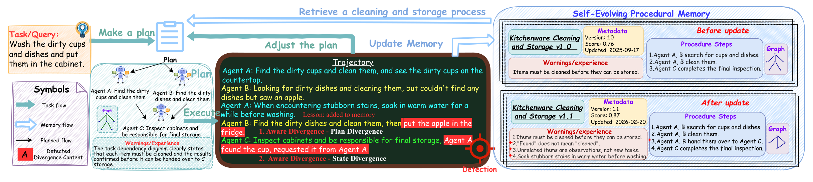<br>
  <sub><b>Cleaning-and-storage example.</b> Plan divergence (B stores an apple) and state divergence (C requests a cup that is found but not cleaned) trigger realignment, and the executed procedure is revised from v1.0 to v1.1.</sub>
</p>

1. **Retrieve and instantiate.** *Kitchenware Cleaning and Storage v1.0* assigns cup cleaning to A, dish cleaning to B, and storage to C; its edges encode that an item must be cleaned before it is stored.
2. **Detect divergence.** B stores an apple, an action outside its subgraph (**plan divergence**). C requests a cup that A has only found (**state divergence**: "found" establishes location, not cleanliness).
3. **Realign without discarding progress.** B returns to dish cleaning. C's storage step waits under the readiness rule until A's cleaning is verified, while cabinet inspection proceeds in parallel.
4. **Revise memory under evidence.** The verified steps and supported edges form candidate *v1.1*, committed after passing the gates; "found ≠ cleaned" is attached as a conditional warning.

---

## ✨ Main Results

All numbers in this section are reported in the paper. Every memory starts empty and is built online over the same task sequence with the same retrieval count and context budget; planning, execution, memory, and the goal-consistency judge use `gpt-5-mini`.

| Benchmark | What it tests | Scale | Metric |
| --- | --- | --- | --- |
| [ALFWorld](https://github.com/alfworld/alfworld) | Text-based household tasks | 134 tasks | Success rate |
| [WebArena](https://github.com/web-arena-x/webarena) | Stateful web tasks | 812 tasks | Functional evaluator |
| [OfficeBench](https://github.com/zlwang-cs/OfficeBench) | Cross-application office workflows | 300 tasks | Task evaluator |
| [MultiAgentBench](https://github.com/ulab-uiuc/MARBLE) | Coding, research, and database collaboration | 3 × 100 tasks | Task / Coordination Score |
| TDW-MAT and C-WAH | Embodied cooperation with physical handoffs | 24 episodes; C-WAH | Transport rate / steps |
| [ImplicitMemBench](https://github.com/chonghanqin/ImplicitMemBench) | Whether earlier experience changes later behavior | 300 items | Benchmark score |

### 1. First in all six host–benchmark settings

<table>
  <thead>
    <tr><th rowspan="2" align="left">Memory</th><th colspan="4">AutoGen</th><th colspan="4">DyLAN</th></tr>
    <tr><th>ALFWorld</th><th>WebArena</th><th>OfficeBench</th><th>Avg.</th><th>ALFWorld</th><th>WebArena</th><th>OfficeBench</th><th>Avg.</th></tr>
  </thead>
  <tbody>
    <tr><td>No added memory</td><td align="right">59.45</td><td align="right">12.44</td><td align="right">41.33</td><td align="right">37.74</td><td align="right">53.98</td><td align="right">14.90</td><td align="right">33.56</td><td align="right">34.15</td></tr>
    <tr><td>Generative Agents</td><td align="right">85.32</td><td align="right">15.27</td><td align="right">38.67</td><td align="right">46.42</td><td align="right">65.17</td><td align="right">15.27</td><td align="right">32.89</td><td align="right">37.78</td></tr>
    <tr><td>MetaGPT</td><td align="right">77.86</td><td align="right">25.99</td><td align="right">45.11</td><td align="right">49.65</td><td align="right">49.50</td><td align="right">22.41</td><td align="right">35.22</td><td align="right">35.71</td></tr>
    <tr><td>G-Memory</td><td align="right">83.08</td><td align="right">30.30</td><td align="right">49.67</td><td align="right">54.35</td><td align="right">62.19</td><td align="right">25.49</td><td align="right">42.44</td><td align="right">43.37</td></tr>
    <tr><td>LEGOMem</td><td align="right">84.08</td><td align="right">31.65</td><td align="right">51.33</td><td align="right">55.69</td><td align="right">63.68</td><td align="right">26.35</td><td align="right">43.78</td><td align="right">44.60</td></tr>
    <tr><td>MATM</td><td align="right">81.34</td><td align="right">29.31</td><td align="right">48.44</td><td align="right">53.03</td><td align="right">61.44</td><td align="right">24.75</td><td align="right">41.22</td><td align="right">42.47</td></tr>
    <tr><td>AWM<sup>†</sup></td><td align="right">80.10</td><td align="right">26.48</td><td align="right">46.44</td><td align="right">51.01</td><td align="right">60.70</td><td align="right">23.40</td><td align="right">38.89</td><td align="right">41.00</td></tr>
    <tr><td>Memp<sup>†</sup></td><td align="right">82.09</td><td align="right">27.34</td><td align="right">47.22</td><td align="right">52.22</td><td align="right">62.44</td><td align="right">24.14</td><td align="right">39.56</td><td align="right">42.05</td></tr>
    <tr><td><b>SEPM (ours)</b></td><td align="right"><b>89.05</b></td><td align="right"><b>38.30</b></td><td align="right"><b>54.44</b></td><td align="right"><b>60.60</b></td><td align="right"><b>68.41</b></td><td align="right"><b>29.80</b></td><td align="right"><b>47.11</b></td><td align="right"><b>48.44</b></td></tr>
  </tbody>
</table>

<sub>ALFWorld and OfficeBench: mean of three shuffled task orders; WebArena: one run. <sup>†</sup> Single-agent memory adapted to the team with role-specific allocation (following LEGOMem).</sub>

- SEPM exceeds the strongest baseline (Generative Agents on ALFWorld, LEGOMem elsewhere) by **3.73 / 6.65 / 3.11** points under AutoGen and **3.23 / 3.45 / 3.33** under DyLAN.
- All six gains over no added memory are significant (*p* < 10<sup>−4</sup>), and the margin over the strongest baseline is significant in four settings (*p* < 0.05).
- **Coordination or memory?** When every baseline runs inside SEPM's blackboard and alignment, their memories add only 0.51–2.30 points, whereas SEPM's memory adds 4.86: *what* the team stores matters beyond *how* it coordinates.

### 2. The gain comes from checkable graphs, not from better text

<table>
  <tr>
    <td width="52%" valign="top">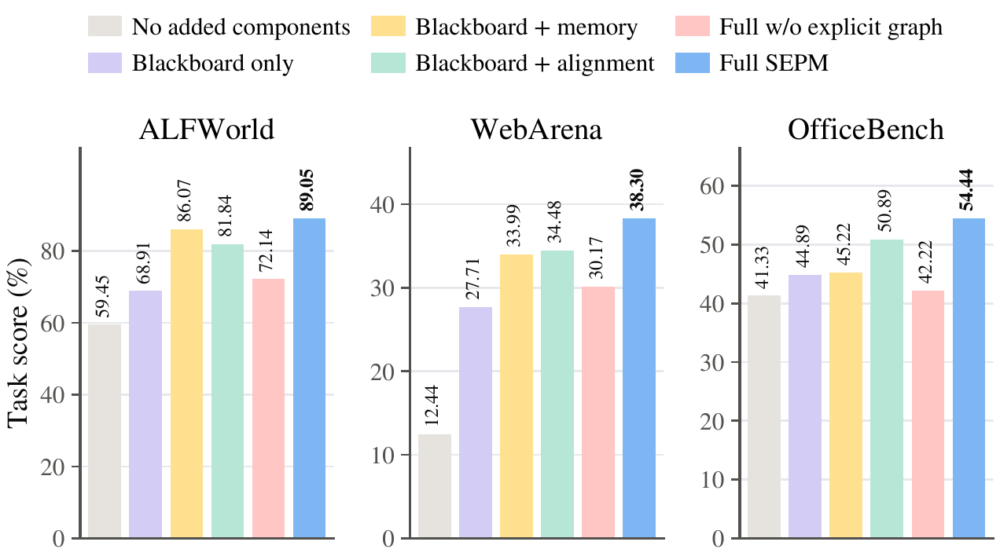</td>
    <td width="48%" valign="top">

**Full w/o explicit graph** states each step's prerequisites as text instead of edges, in both execution and memory, and loses **16.91 / 8.13 / 12.22** points on ALFWorld / WebArena / OfficeBench.

Of these losses, **14.92 / 5.91 / 9.34** points come from executing without the graph (readiness and plan comparison must recover prerequisites from descriptions), and **1.99–2.88** from storing prerequisites as text.

Storing every observed precedence instead of evidence-supported edges costs **2.55–3.73** points and lowers edge precision from 0.86 to 0.45 on ALFWorld.

</td>
  </tr>
</table>

### 3. Memory that keeps improving and transfers

<table>
  <tr>
    <td width="50%" align="center" valign="top">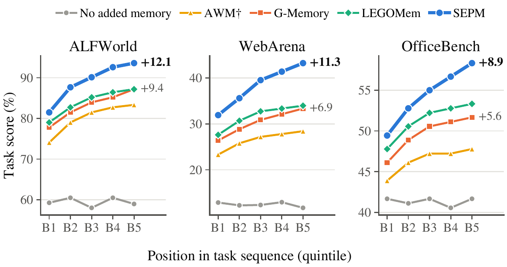<br><sub><b>Along the task sequence.</b> From B1 to B5, SEPM gains <b>12.11 / 11.31 / 8.89</b> points vs. 9.40 / 6.95 / 5.56 for G-Memory.</sub></td>
    <td width="50%" align="center" valign="top">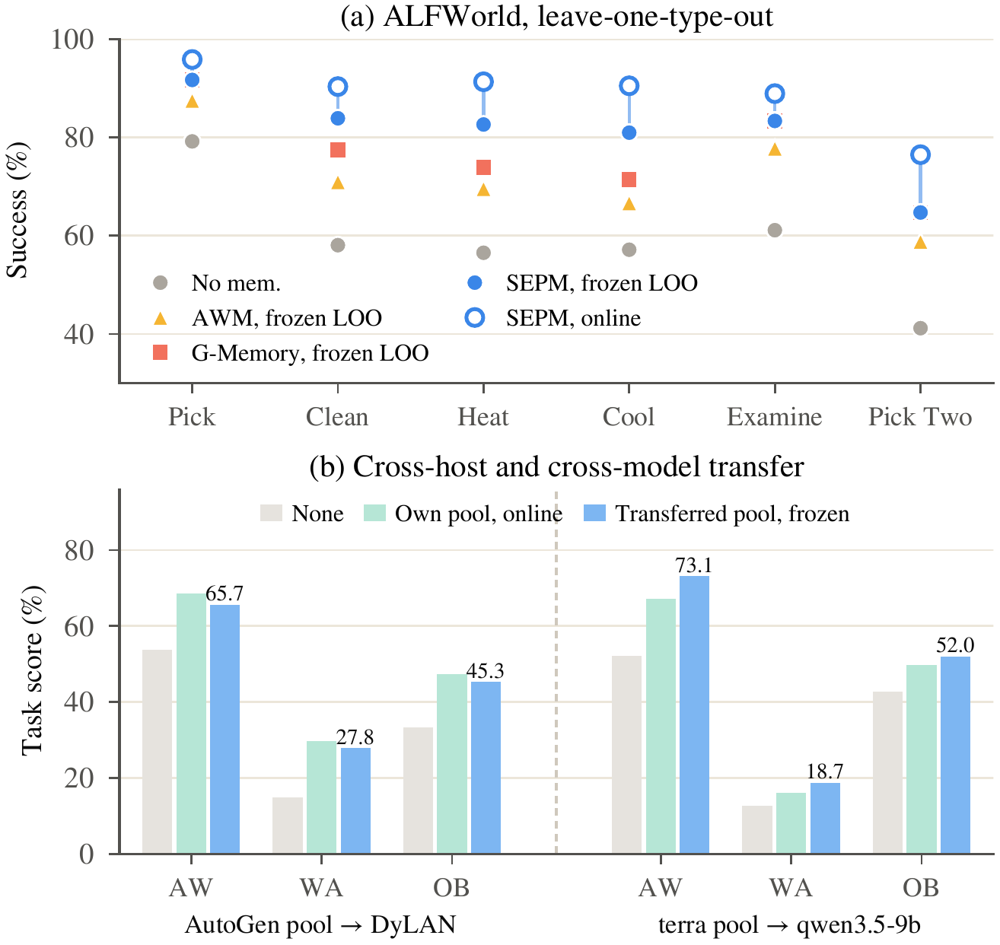<br><sub><b>Frozen pools.</b> Held-out ALFWorld type: <b>82.09%</b> (G-Memory 77.61%). An AutoGen pool recovers <b>80–87%</b> of DyLAN's online gain.</sub></td>
  </tr>
</table>

Accumulation is **selective**: most candidate revisions are rejected (133/164, 737/904, 283/354), most often by the dependency gate. Removing that gate admits nearly twice as many revisions and lowers scores by 2.98 / 2.09 / 2.34 points.

### 4. Beyond the three main benchmarks

<table>
  <tr>
    <td width="50%" align="center" valign="top">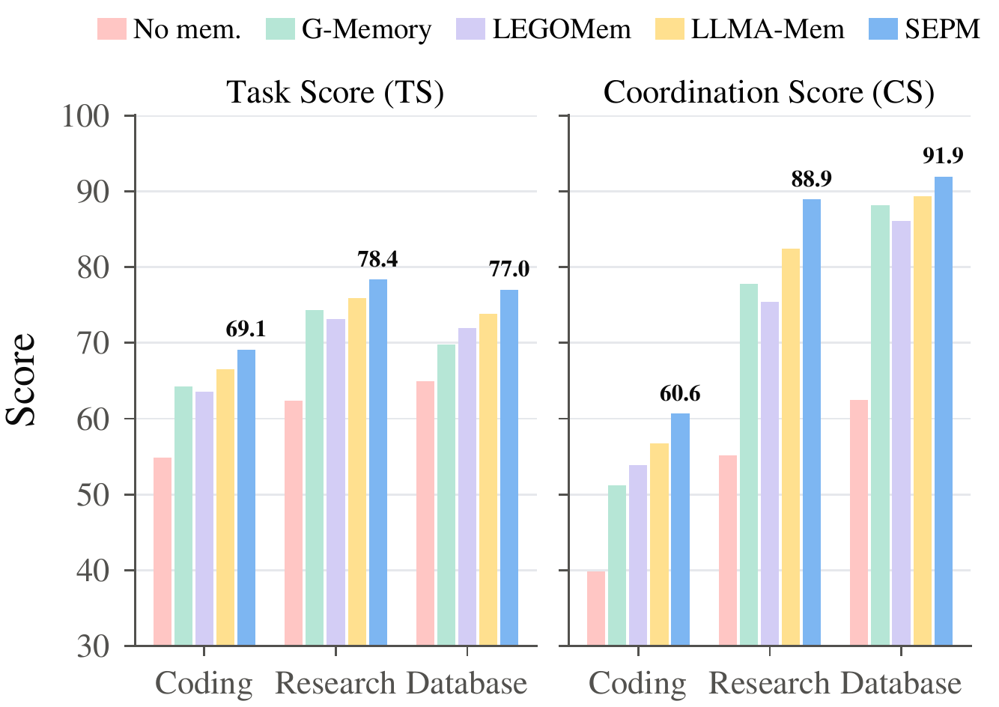<br><sub><b>MultiAgentBench.</b> SEPM improves on LLMA-Mem by <b>2.44–3.17 TS</b> and <b>2.57–6.45 CS</b>.</sub></td>
    <td width="50%" align="center" valign="top">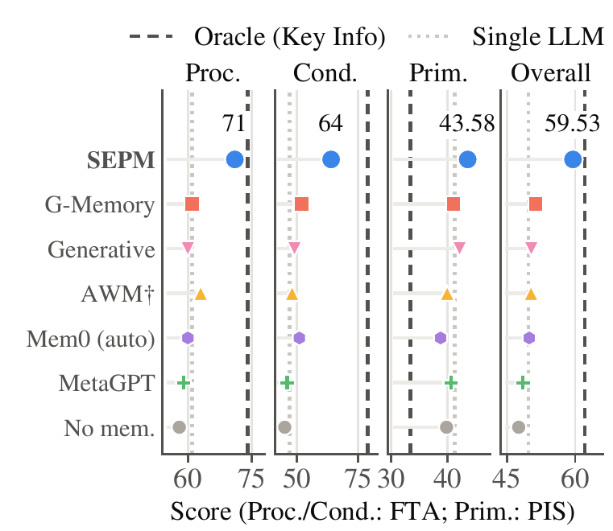<br><sub><b>ImplicitMemBench.</b> <b>47.61 → 59.53</b> with <code>gpt-5-mini</code>; no baseline gains more than 3.75 points.</sub></td>
  </tr>
</table>

| Embodied cooperation (CoELA host) | TDW-MAT Food ↑ | TDW-MAT Stuff ↑ | TDW-MAT Avg. ↑ | C-WAH Steps ↓ |
| --- | ---: | ---: | ---: | ---: |
| No added memory | 68.33 | 58.33 | 63.33 | 92.4 |
| G-Memory | 72.50 | 61.67 | 67.08 | 87.1 |
| AWM<sup>†</sup> | 70.83 | 60.00 | 65.42 | 88.5 |
| LEGOMem | 73.33 | 62.50 | 67.92 | 85.6 |
| **SEPM (ours)** | **79.17** | **68.33** | **73.75** | **79.8** |

Across the six execution and memory models evaluated with and without memory, the gain stays positive in **all 18 model–benchmark pairs** (3.33 to 29.85 points), and SEPM uses fewer tokens than Generative Agents, G-Memory, and LEGOMem on all three main benchmarks.

---

## 🚀 Quick Start

### 1. Install

Python 3.10 or newer. The core package depends only on Pydantic.

```bash
git clone https://github.com/cookieApril/SEPM.git && cd SEPM
python -m venv .venv && source .venv/bin/activate     # Windows: .venv\Scripts\activate
pip install -e ".[dev]"                               # add ",eval" for the benchmark harnesses
```

### 2. Run the end-to-end example (no API key needed)

```bash
python examples/end_to_end.py                 # register agents, plan, validate, publish, retrieve
sepm --db sepm_demo.db candidates             # inspect stored candidates
sepm --db sepm_demo.db retrieve "verified catalog results"
```

### 3. Check the implementation

```bash
pytest -q                                     # unit and integration-contract tests
ruff check src adapters tests
sepm-benchmark --output benchmark-results/mechanism/report.json   # deterministic mechanism checks
```

`sepm-benchmark` exercises divergence detection, evidence resolution, promotion gates, and retrieval without an LLM.

### 4. Use SEPM as a memory plug-in

[`sepm.plugins`](src/sepm/plugins/) defines one contract that SEPM and the included baselines (official G-Memory, Generative Agents, and MetaGPT memory classes; Mem0) implement, so a host can swap memories without other changes:

```python
from sepm.llm_client import LLMClient, UsageMeter
from sepm.plugins.sepm_plugin import SEPMPlugin

memory = SEPMPlugin(database_path="pool.db", task_family="my_tasks",
                    client=LLMClient(), meter=UsageMeter())
memory.begin_task("task-1", goal)
prompt_block = memory.context("agent-a", goal)             # procedures + warnings for the prompt
corrections = memory.record("agent-a", action, observation)  # blackboard + alignment
memory.end_task(success=True, reward=1.0)                   # outcome, trials, extraction
```

For lower-level control, [`SEPMService`](src/sepm/service.py) is the Python facade and [`AgentMemoryAdapter`](src/sepm/adapter.py) exposes agent-start, agent-step, and procedure-outcome hooks. The storage layout is described in [`docs/STORAGE_SCHEMA.md`](docs/STORAGE_SCHEMA.md).

### 5. Configure model access

```bash
cp .env.example .env      # set OPENAI_API_KEY and OPENAI_BASE_URL (any OpenAI-compatible endpoint)
```

---

## 🧪 Running the Benchmarks

The upstream benchmarks are installed under `external/` (see [`docs/BENCHMARKS.md`](docs/BENCHMARKS.md)).

| Benchmark | Platform | Command |
| --- | --- | --- |
| ImplicitMemBench | any OS | `bash scripts/run_local_suite.sh {main\|interference\|accumulate}` |
| MultiAgentBench coding / research | any OS | `bash scripts/run_local_suite.sh mab` |
| ALFWorld, OfficeBench | Linux + Docker | `bash scripts/run_linux_suite.sh {smoke\|e1\|ablation\|loo\|transfer\|sensitivity\|teamsize}` |
| MultiAgentBench database | Linux + Docker | `bash scripts/run_linux_suite.sh mab-db` |
| Report | any OS | `python -m sepm.bench.report` → `benchmark-results/REPORT.md` |

The matrix-driven runner reads [`evaluation_matrix.json`](evaluation_matrix.json):

```bash
python scripts/validate_paper_setup.py --require-jobs   # checks jobs, paths, and credentials
bash scripts/run_paper_experiments.sh all               # preflight → smoke → matrices → ablation → report
sepm-eval --help && sepm-ablation --help                # filters for individual cells and stages
```

**Protocol.** Each condition starts from an empty procedure pool in its own SQLite database (override with `TEAM_MEMORY_DB`). ALFWorld and OfficeBench use base seeds 0, 1, 2 (seeds 1 and 2 shuffle the task order); all other analyses use seed 0. All hyperparameters were fixed before evaluation. Harness-level choices are listed in [`docs/IMPLEMENTATION_NOTES.md`](docs/IMPLEMENTATION_NOTES.md).

<details>
<summary><b>Default hyperparameters</b></summary>

| Module | Setting | Default |
| --- | --- | --- |
| Retrieval | Procedures per task *K* | 5 |
| Retrieval | BM25 | *k*<sub>1</sub> = 1.5, *b* = 0.75 |
| Retrieval | Text representation | 256-d BLAKE2b signed feature hashing, ℓ<sub>2</sub>-normalized |
| Retrieval | BM25 / hashed-feature weights without a routing cue | 0.50 / 0.50 |
| Goal alignment | β (text dissimilarity vs. LLM judge), δ<sub>g</sub> | 0.55, 0.35 |
| Plan alignment | δ<sub>p</sub> | 0.40 |
| State resolution | Evidence-confidence threshold | 0.70 |
| Promotion | Safety-risk threshold | 0.50 |
| Promotion | Dependency-support threshold *c*<sub>dep</sub> | 0.65 |
| Promotion | Qualified trials *m* | 1 |
| Promotion | Cost weight λ in net benefit | 1.0 |

</details>

---

## 📁 Project Structure

```text
SEPM/
├── src/sepm/                 # Core library
│   ├── models.py, storage.py     # task graphs, blackboard, versioned SQLite store
│   ├── retrieval.py              # BM25 + hashed-feature retrieval with adaptive weights
│   ├── divergence.py, alignment.py, evidence.py   # goal / plan / state alignment
│   ├── episode.py, service.py, safety.py          # extraction, promotion gates, versioning
│   ├── plugins/                  # memory plug-in contract: SEPM, G-Memory family, Mem0
│   ├── hosts/                    # AutoGen-style team host
│   ├── bench/                    # ImplicitMemBench and MultiAgentBench harnesses, report
│   └── ablation/                 # component-ablation runner
├── adapters/                 # ALFWorld / OfficeBench / MARBLE bridges
├── scripts/                  # experiment suites, setup validation, upstream patches
├── manifests/                # selected case IDs
├── examples/end_to_end.py    # runnable procedure lifecycle
├── tests/                    # unit and integration-contract tests
├── docs/                     # benchmarks guide, implementation notes, storage schema, figures
├── evaluation_matrix.json    # experiment matrix
├── environment.yml           # full Conda environment
└── pyproject.toml
```

---

## 📊 More Results

<details>
<summary><b>A. Statistical significance</b></summary>

| Host | Benchmark | Δ | W/T/L or (*b*, *c*) | 95% CI | *p* |
| --- | --- | ---: | :---: | :---: | ---: |
| AutoGen | ALFWorld | +29.60 | 61 / 65 / 8 | [21.89, 37.31] | < 10<sup>−5</sup> |
| AutoGen | WebArena | +25.86 | (24, 234) | [22.54, 29.31] | 1.9 × 10<sup>−44</sup> |
| AutoGen | OfficeBench | +13.11 | 102 / 168 / 30 | [9.11, 17.00] | < 10<sup>−5</sup> |
| DyLAN | ALFWorld | +14.43 | 46 / 73 / 15 | [7.96, 21.14] | 7 × 10<sup>−5</sup> |
| DyLAN | WebArena | +14.90 | (38, 159) | [11.70, 18.10] | 8.5 × 10<sup>−19</sup> |
| DyLAN | OfficeBench | +13.56 | 103 / 168 / 29 | [9.44, 17.67] | < 10<sup>−5</sup> |

<sub>Paired sign-flip permutation test (200,000 permutations) and paired bootstrap for ALFWorld and OfficeBench; exact McNemar test for WebArena.</sub>

</details>

<details>
<summary><b>B. Component interaction and cost</b></summary>

<p align="center">
  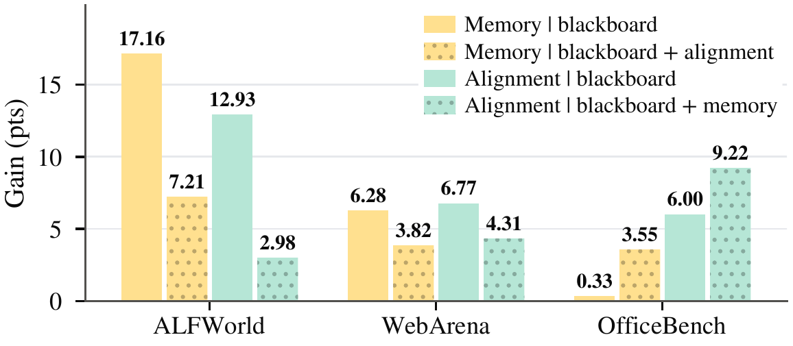 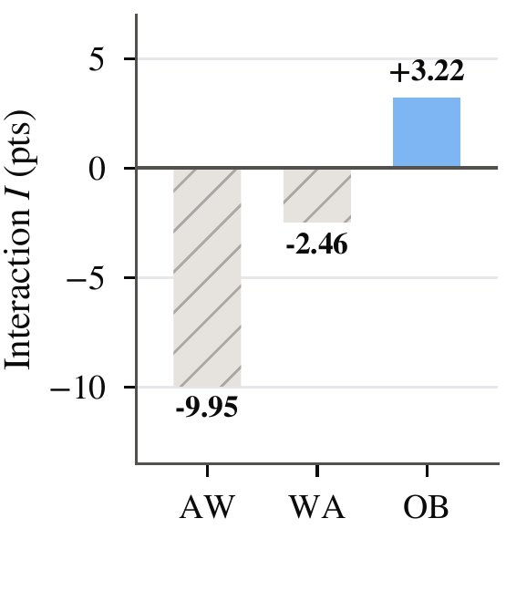
</p>

Memory adds 17.16 points to the blackboard on ALFWorld. On OfficeBench, memory and alignment are complementary (*I* = +3.22); on ALFWorld and WebArena they partly overlap.

| Memory (AutoGen, seed 0) | ALFWorld tokens (M) | WebArena tokens (M) | OfficeBench tokens (M) |
| --- | ---: | ---: | ---: |
| No added memory | 4.4 | 61.8 | 8.7 |
| Generative Agents | 5.6 | 74.3 | 11.0 |
| G-Memory | 5.7 | 76.9 | 11.2 |
| LEGOMem | 5.4 | 72.8 | 10.6 |
| **SEPM** | 5.2 | 71.4 | 10.3 |

</details>

<details>
<summary><b>C. Procedure-pool dynamics</b></summary>

| Statistic (AutoGen, seed 0) | ALFWorld | WebArena | OfficeBench |
| --- | ---: | ---: | ---: |
| Candidates proposed | 187 | 1046 | 412 |
| ↳ added as new procedures | 23 | 142 | 58 |
| ↳ promoted as revisions | 31 | 167 | 71 |
| ↳ rejected: safety / state | 4 / 29 | 31 / 176 | 9 / 72 |
| ↳ rejected: dependency / qualification | 41 / 38 | 219 / 203 | 88 / 74 |
| ↳ rejected: net benefit | 21 | 108 | 40 |
| Conditional warnings attached | 96 | 588 | 231 |
| Procedures at end | 32 | 189 | 75 |

</details>

<details>
<summary><b>D. Robustness: alignment hyperparameters, task orders, interference</b></summary>

<p align="center">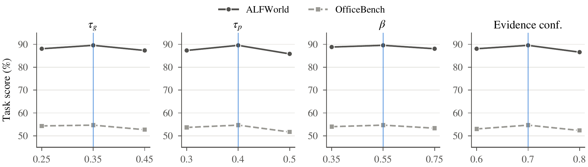</p>
<p align="center">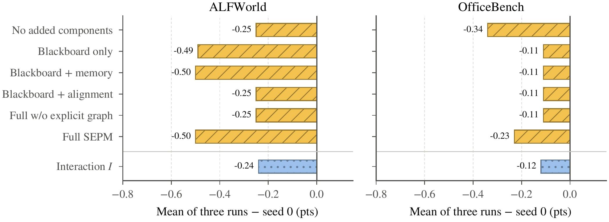 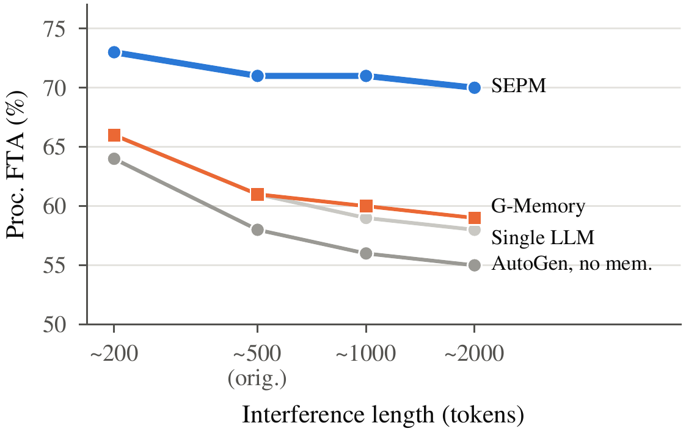</p>

Across tested thresholds, scores vary by at most 3.73 points on ALFWorld and 3.00 on OfficeBench. Ablation results shift by at most 0.50 points across task orders. From ~200 to ~2000 interference tokens, SEPM's procedural-memory score drops only from 73 to 70.

</details>

---

## 📚 Citation

```bibtex
@misc{liu2026sepm,
  title         = {SEPM: Self-Evolving Procedural Memory Grounded in Task Graphs for Multi-Agent Collaboration},
  author        = {Yi Liu and Junwei Zhao and Li Sun and Jiansong Zhang and Sen Su},
  year          = {2026},
  eprint        = {2610.14515},
  archivePrefix = {arXiv},
  primaryClass  = {cs.MA},
  url           = {https://arxiv.org/abs/2610.14515}
}
```

## 📞 Contact

Questions and suggestions are welcome: **Yi Liu** ([louie@bupt.edu.cn](mailto:louie@bupt.edu.cn)), or open an issue.

## 📄 License

Released under the [MIT License](LICENSE).
